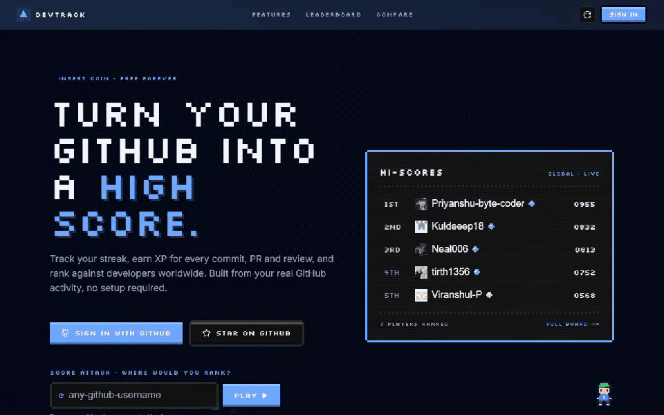

<div align="center">

# ▲ DevTrack

**Turn your GitHub into a high score.**

Streaks, XP, tiers and a global leaderboard, built from the GitHub activity you already have.
Look anyone up, duel your friends, flex it in your README. Free, open source and self-hostable.

<br />

[](https://devtrack.live)
[](https://github.com/Priyanshu-byte-coder/devtrack/actions/workflows/ci.yml)
[](./LICENSE)
[](https://nextjs.org)
[](https://github.com/Priyanshu-byte-coder/devtrack/stargazers)
[](https://github.com/Priyanshu-byte-coder/devtrack/graphs/contributors)
[](https://github.com/Priyanshu-byte-coder/devtrack/issues?q=is%3Aissue+is%3Aopen+label%3A%22good+first+issue%22)
[](https://github.com/Priyanshu-byte-coder/devtrack/issues?q=is%3Aissue+is%3Aopen+label%3A%22hacktoberfest%22)

<br />

[**Play now**](https://devtrack.live) · [**Leaderboard**](https://devtrack.live/leaderboard) · [**Guides**](https://devtrack.live/guides) · [**Contributing**](#contributing) · [**Report a bug**](https://github.com/Priyanshu-byte-coder/devtrack/issues/new?template=bug_report.yml) · [**Discussions**](https://github.com/Priyanshu-byte-coder/devtrack/discussions)

<br />



<sub><b>Score attack:</b> type any GitHub username and see where they'd rank. No sign-up needed.</sub>

</div>

---

## What is DevTrack?

DevTrack reads your GitHub activity (commits, pull requests, reviews, active days) and turns it into a game you can actually play:

- **A score and a rank.** A 0–1000 DevTrack score, six tiers from Bronze to Legend, XP and levels, and a global leaderboard with monthly and weekly seasons.
- **Anyone, instantly.** Every GitHub user has a player card at `devtrack.live/u/<username>`, so you can look up friends, idols or rivals without them signing up.
- **Bragging rights.** Duel anyone round by round, share a pixel card, and put live badges in your README.
- **A real dashboard underneath.** Streaks, a contribution heatmap, PR and review analytics, repositories, goals and AI career tools, all from one GitHub sign-in.

If DevTrack makes you smile, **[star the repo](https://github.com/Priyanshu-byte-coder/devtrack/stargazers)**. Stars are how open-source projects get found.

---

## Take a look

<table>
  <tr>
    <td width="50%" align="center">
      
      <br /><sub><b>Hi-score table</b>: overall, streak, commits and PR boards, by language, for the week, month or all time</sub>
    </td>
    <td width="50%" align="center">
      
      <br /><sub><b>Duels</b>: any two GitHub users, eight rounds, one shareable result</sub>
    </td>
  </tr>
  <tr>
    <td width="50%" align="center">
      
      <br /><sub><b>Player cards</b>: rank, tier, level and XP, a 30-day commit chart and a share card</sub>
    </td>
    <td width="50%" align="center">
      
      <br /><sub><b>HQ</b>: your week as a game HUD, your season rank, and everything else one click away</sub>
    </td>
  </tr>
  <tr>
    <td width="50%" align="center">
      
      <br /><sub><b>Year in Code</b>: your year as a run of levels, with a share card at the end</sub>
    </td>
    <td width="50%" align="center">
      
      <br /><sub><b>Top developers</b>: by language and by country, updated daily</sub>
    </td>
  </tr>
</table>

---

## Flex it in your README

Live, animated pixel badges that update on their own. Here are the maintainer's:

<p align="center">
  <a href="https://devtrack.live/u/priyanshu-byte-coder"></a>
  <a href="https://devtrack.live/u/priyanshu-byte-coder"></a>
  <a href="https://devtrack.live/u/priyanshu-byte-coder"></a>
</p>

Sign in once, then paste this into your profile README (replace `YOUR_LOGIN`):

```md
[](https://devtrack.live/u/YOUR_LOGIN)
[](https://devtrack.live/u/YOUR_LOGIN)
[](https://devtrack.live/u/YOUR_LOGIN)
```

The rank badge also takes `&board=month` or `&board=week`. Full details: [BADGE_API.md](./BADGE_API.md) and the [README stats guide](https://devtrack.live/guides/github-stats-readme).

---

## Features

**Play**

- DevTrack score (0–1000) from consistency, impact, volume and breadth; six tiers from Bronze to Legend
- XP for every commit, PR and review, with levels that never go down
- Global leaderboard: overall, streak, commits and PRs, filterable by language, with weekly and monthly seasons, a podium and daily rank changes
- Score attack on the home page: see where any GitHub user would rank
- Duels between any two GitHub users, with shareable result cards
- Top developers by language (20) and by country (28)
- Year in Code: your year as a shareable run of levels
- Bit, the pixel mascot: tips on every page, a little trash talk on the leaderboard

**Your dashboard**

- Weekly HUD, season rank card and level-up celebrations
- Contribution heatmap, streaks with freezes, consistency score and productive hours
- Pull request, review, issue and CI analytics
- Repositories, language loadout, repo health and repo comparison
- Goals as a quest log, milestones and a daily focus
- AI tools: resume generator, coding personality, project tutor and weekly insights

**Share**

- Public player card at `/u/<username>` for members, and an estimated card for any GitHub user
- Pixel README badges for rank, streak and monthly commits
- Share cards (Open Graph images) for profiles, duels and Year in Code
- RSS feed of your public activity

**Platform**

- Sign in with GitHub, multi-account switching and GitHub organisations
- New players start on the public leaderboard and can hide in one click
- Themes, English and Spanish, PWA support, Discord, Slack and WakaTime integrations, weekly email digest
- Full data export and account deletion

---

## Quick start

**1. Just play:** [devtrack.live](https://devtrack.live). Nothing to install.

**2. Deploy your own** in one click. You'll need a free [Supabase](https://supabase.com) project and a [GitHub OAuth App](https://github.com/settings/applications/new).

[](https://vercel.com/new/clone?repository-url=https%3A%2F%2Fgithub.com%2FPriyanshu-byte-coder%2Fdevtrack&project-name=devtrack&repository-name=devtrack&env=NEXT_PUBLIC_SUPABASE_URL,NEXT_PUBLIC_SUPABASE_ANON_KEY,SUPABASE_SERVICE_ROLE_KEY,NEXTAUTH_URL,NEXTAUTH_SECRET,GITHUB_ID,GITHUB_SECRET,ENCRYPTION_KEY&envDescription=Supabase%20keys%2C%20GitHub%20OAuth%20app%20credentials%2C%20and%20a%20NextAuth%20secret&envLink=https%3A%2F%2Fgithub.com%2FPriyanshu-byte-coder%2Fdevtrack%2Fblob%2Fmain%2FDEVELOPMENT.md)

**3. Run it locally**

```bash
git clone https://github.com/Priyanshu-byte-coder/devtrack.git
cd devtrack
pnpm install
cp .env.example .env.local   # fill in Supabase + GitHub OAuth credentials
pnpm dev
```

Open [http://localhost:3000](http://localhost:3000) and sign in with GitHub.

The full walkthrough (database migrations, OAuth app setup, every environment variable) is in **[DEVELOPMENT.md](./DEVELOPMENT.md)**. Prefer containers? See the **[Docker guide](./docs/docker.md)**. Running your own production instance? See the **[self-hosting guide](./docs/self-hosting.md)**.

---

## Tech stack

| Layer      | Technology                                                                  |
| ---------- | --------------------------------------------------------------------------- |
| Frontend   | Next.js 16 (App Router), React, TypeScript, Tailwind CSS, Motion            |
| Look       | Arcade pixel design system (Silkscreen, `.px-*` classes), SVG pixel sprites |
| Auth       | GitHub OAuth via NextAuth.js                                                |
| Data       | Supabase (PostgreSQL) with Row Level Security; GitHub GraphQL and REST APIs |
| Charts     | Recharts                                                                    |
| AI         | Anthropic Claude and Groq                                                   |
| i18n       | next-intl (English, Spanish)                                                |
| Testing    | Vitest, Playwright (end-to-end and visual regression)                       |
| Deployment | Vercel and Supabase free tiers                                              |

---

## Documentation

| Guide                                              | What it covers                                                        |
| -------------------------------------------------- | --------------------------------------------------------------------- |
| [DEVELOPMENT.md](./DEVELOPMENT.md)                 | Local setup, environment variables, project structure, adding widgets |
| [Self-hosting guide](./docs/self-hosting.md)       | Deploying your own production instance                                |
| [Docker guide](./docs/docker.md)                   | Containerised local development                                       |
| [Architecture](./docs/architecture.md)             | System diagrams: frontend, API routes, Supabase schema, sync flows    |
| [API reference](./docs/api.md)                     | REST API guide; interactive Swagger UI at `/api-docs`                 |
| [Badge API](./BADGE_API.md)                        | README badges: endpoints, parameters, caching                         |
| [FAQ](./docs/faq.md)                               | OAuth setup, sign-in issues, the leaderboard, testing                 |
| [Caching](./docs/caching.md)                       | Caching patterns used across the codebase                             |
| [Guides on the site](https://devtrack.live/guides) | GitHub stats in your README, streaks, comparing profiles, the score   |

---

## Contributing

DevTrack is built by its community: over two hundred developers have shipped code here, many with their first-ever open-source contribution. Every experience level is welcome, and maintainers review and mentor.

**Getting started takes four steps:**

1. Browse [open issues](https://github.com/Priyanshu-byte-coder/devtrack/issues). The [`good first issue`](https://github.com/Priyanshu-byte-coder/devtrack/issues?q=is%3Aissue+is%3Aopen+label%3A%22good+first+issue%22) label is curated for newcomers.
2. Comment on the issue to get assigned before you start.
3. Fork, branch from `main` (for example `feat/issue-42-description`) and open a PR.
4. Make sure CI passes locally: `pnpm run lint && pnpm run type-check && pnpm test`.

**[CONTRIBUTING.md](./CONTRIBUTING.md)** covers commit style, branch naming and the review process. Questions are always welcome in [Discussions](https://github.com/Priyanshu-byte-coder/devtrack/discussions).

DevTrack takes part in **Hacktoberfest**: look for the [`hacktoberfest`](https://github.com/Priyanshu-byte-coder/devtrack/issues?q=is%3Aissue+is%3Aopen+label%3A%22hacktoberfest%22) label, and `level:*` labels for difficulty.

**Looking for something bigger?** Open an issue to claim one of these and discuss the approach first:

| Idea                                       | Difficulty   |
| ------------------------------------------ | ------------ |
| Friend leagues (private leaderboards)      | Intermediate |
| More languages for the UI                  | Beginner     |
| Achievements and quests from GitHub events | Intermediate |
| GitLab and Bitbucket accounts              | Advanced     |
| Team dashboards                            | Advanced     |

---

## Community and support

- [GitHub Discussions](https://github.com/Priyanshu-byte-coder/devtrack/discussions): questions, ideas, show what you've built
- [Issues](https://github.com/Priyanshu-byte-coder/devtrack/issues/new/choose): bug reports and feature requests
- [Email the maintainer](mailto:doshipriyanshu3@gmail.com): anything else

Everyone is expected to follow the [Code of Conduct](./CODE_OF_CONDUCT.md). Security issues: see [SECURITY.md](./SECURITY.md).

---

## Support the project

DevTrack is free, open source and runs on donated infrastructure. Three ways to help, in order of impact:

1. **Star the repository.** It costs nothing and helps other developers find the project.
2. **Contribute.** Code, docs, bug reports and reviews all move DevTrack forward.
3. **Sponsor.** Funds hosting, AI API costs and maintainer time: [devtrack.live/sponsor](https://devtrack.live/sponsor) · [GitHub Sponsors](https://github.com/sponsors/Priyanshu-byte-coder) · [Buy Me a Chai](https://www.buymeachai.in/devtrack)

Sponsor tiers and a company-ready brief are in [docs/SPONSORS.md](./docs/SPONSORS.md).

DevTrack is built on [Supabase](https://supabase.com), [Vercel](https://vercel.com), [Anthropic](https://anthropic.com), [Groq](https://groq.com) and [WakaTime](https://wakatime.com).

---

## Star history

<div align="center">

<a href="https://star-history.com/#Priyanshu-byte-coder/devtrack&Date">
  <picture>
    <source media="(prefers-color-scheme: dark)" srcset="https://api.star-history.com/svg?repos=Priyanshu-byte-coder/devtrack&type=Date&theme=dark" />
    <source media="(prefers-color-scheme: light)" srcset="https://api.star-history.com/svg?repos=Priyanshu-byte-coder/devtrack&type=Date" />
    
  </picture>
</a>

</div>

---

## License

MIT, see [LICENSE](./LICENSE). The hosted service at devtrack.live has its own [Terms of Service](https://devtrack.live/terms) and [Privacy Policy](https://devtrack.live/privacy-policy).

## Maintainers

| Name            | GitHub                                                           | Role                 |
| --------------- | ---------------------------------------------------------------- | -------------------- |
| Priyanshu Doshi | [@Priyanshu-byte-coder](https://github.com/Priyanshu-byte-coder) | Founder & maintainer |
| Saahil Doshi    | [@Legit-Ox](https://github.com/Legit-Ox)                         | Maintainer           |

## Contributors

Thanks to everyone who has helped build DevTrack. Want your avatar here? Pick a [good first issue](https://github.com/Priyanshu-byte-coder/devtrack/issues?q=is%3Aissue+is%3Aopen+label%3A%22good+first+issue%22) and join in.

<div align="center">

<a href="https://github.com/Priyanshu-byte-coder/devtrack/graphs/contributors">
  
</a>

<br /><br />

Built by the DevTrack community · [devtrack.live](https://devtrack.live)

**Press start, and if DevTrack is useful to you, a star goes a long way.**

</div>

## Audit and repairs

The [2026-10-11 audit](docs/audits/2026-10-11/README.md) records the original code and GitHub backlog. The [repair ledger](docs/repairs/2026-10-11.md) maps each finding to changes and verification. Existing deployments must follow the [database adoption guide](supabase/README.md) before using the repaired schema.
