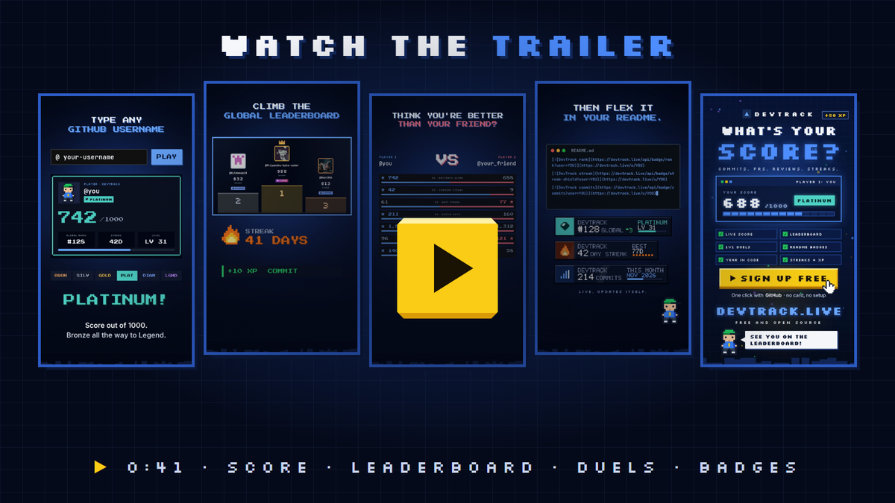
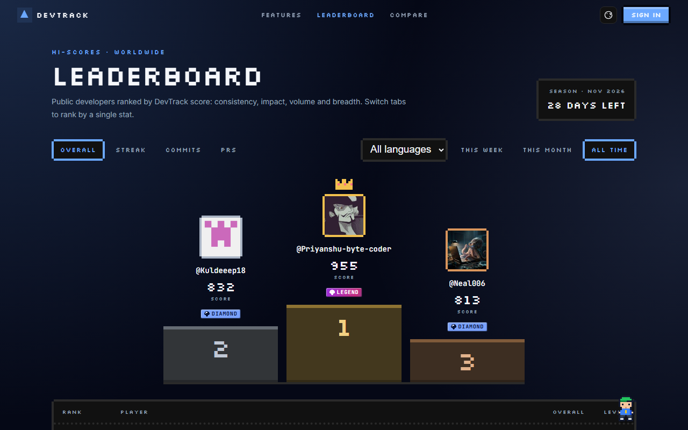
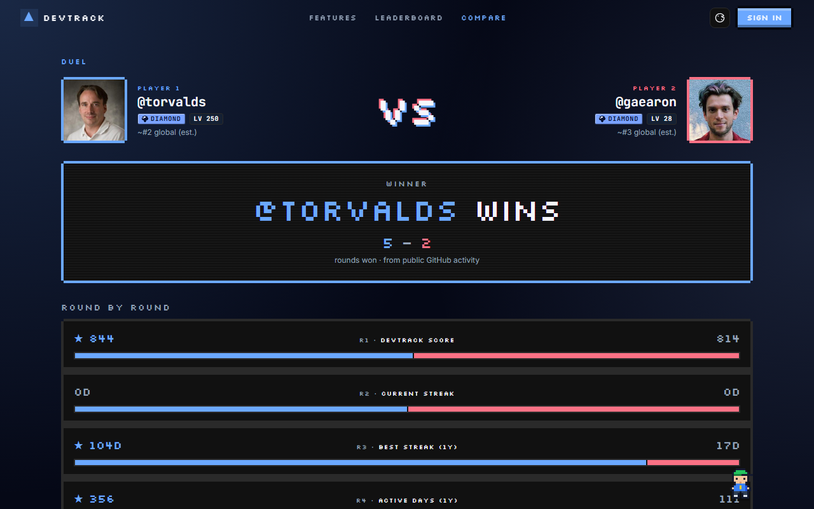
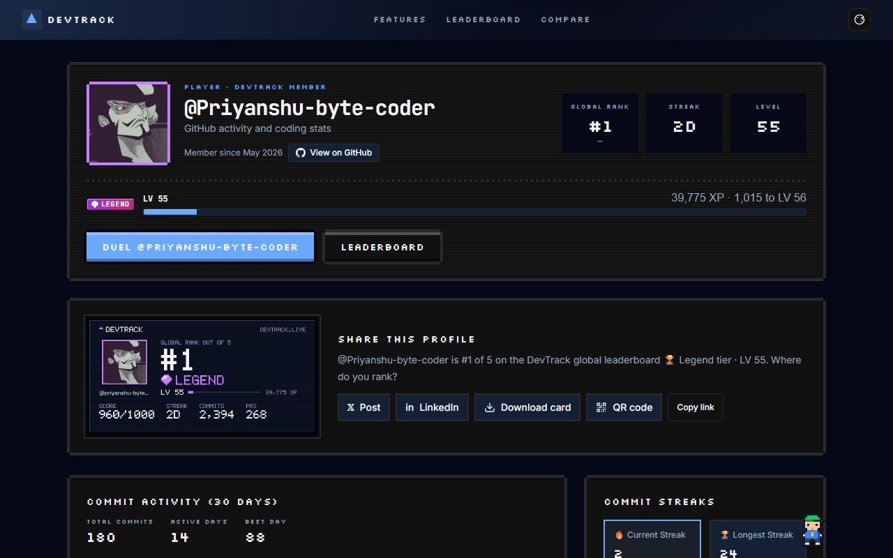
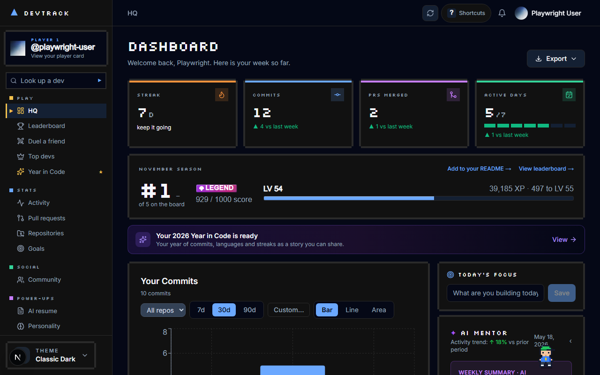
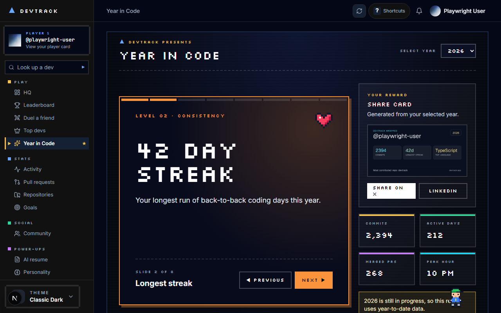
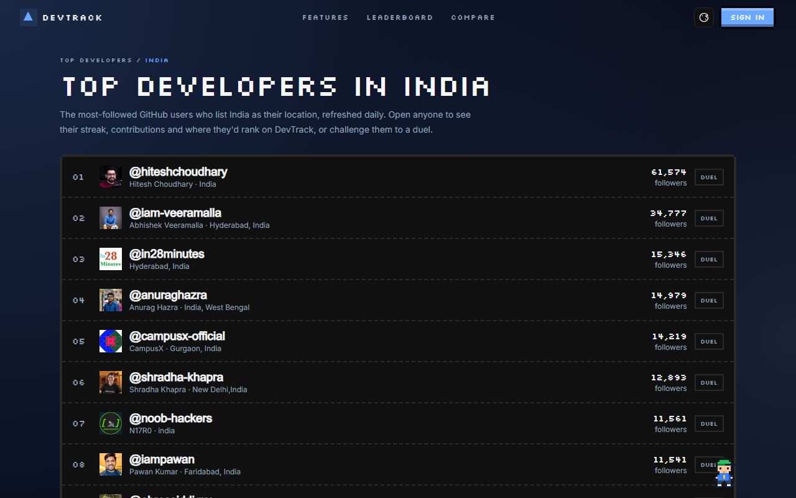

<div align="center">


# ▲ DevTrack

**Turn your GitHub into a high score.**

One ranking for every developer. Your commits, PRs, reviews and streaks become one score,<br />
one tier and one spot on a global leaderboard, built from the GitHub activity you already have.<br />
Look anyone up, duel your friends, flex it in your README. Free, open source and self-hostable.

<br />

[](https://devtrack.live)

[](https://github.com/Priyanshu-byte-coder/devtrack/actions/workflows/ci.yml)
[](./LICENSE)
[](https://nextjs.org)
[](https://github.com/Priyanshu-byte-coder/devtrack/stargazers)
[](https://github.com/Priyanshu-byte-coder/devtrack/network/members)
[](https://github.com/Priyanshu-byte-coder/devtrack/graphs/contributors)
[](https://github.com/Priyanshu-byte-coder/devtrack/issues?q=is%3Aissue+is%3Aopen+label%3A%22good+first+issue%22)
[](https://devtrack.live/sponsor)

<br />

<a href="https://youtube.com/shorts/RuArlADjlmQ"></a>

<sub><b>▶ <a href="https://youtube.com/shorts/RuArlADjlmQ">Watch the trailer</a></b> (0:41, YouTube): score, leaderboard, duels, README badges and more. Or just type any GitHub username at <a href="https://devtrack.live">devtrack.live</a> and see where they'd rank. No sign-up needed.</sub>

<br /><br />

| 🎮 [**Play**](#for-players)                       | 🛠️ [**Build**](#for-contributors)                          | 💎 [**Sponsor**](#for-sponsors)                         |
| ------------------------------------------------- | ---------------------------------------------------------- | ------------------------------------------------------- |
| Get your rank, tier and badges in under a minute. | 280+ contributors, mentoring, and a no-accounts demo mode. | Put your brand where developers check their rank daily. |

</div>

---

## For players

### Three steps to your high score

1. **Press start.** [Sign in with GitHub](https://devtrack.live/auth/signin). You approve on github.com; DevTrack never sees your password.
2. **Get your player card.** Your score (0–1000), tier from Bronze to Legend, XP and level, and your spot on the global leaderboard, built from your real commits, PRs and reviews.
3. **Flex it.** Duel friends, share your card, and drop live badges into your README.

Just curious? Try any username in the [score attack](https://devtrack.live), or open anyone's card at `devtrack.live/u/<username>`. No account needed.

### Take a look

<table>
  <tr>
    <td width="50%" align="center">
      
      <br /><sub><b>Hi-score table</b>: overall, streak, commits and PR boards, by language, for the week, month or all time</sub>
    </td>
    <td width="50%" align="center">
      
      <br /><sub><b>Duels</b>: any two GitHub users, eight rounds, one shareable result</sub>
    </td>
  </tr>
  <tr>
    <td width="50%" align="center">
      
      <br /><sub><b>Player cards</b>: rank, tier, level and XP, a 30-day commit chart and a share card</sub>
    </td>
    <td width="50%" align="center">
      
      <br /><sub><b>HQ</b>: your week as a game HUD, your season rank, and everything else one click away</sub>
    </td>
  </tr>
  <tr>
    <td width="50%" align="center">
      
      <br /><sub><b>Year in Code</b>: your year as a run of levels, with a share card at the end</sub>
    </td>
    <td width="50%" align="center">
      
      <br /><sub><b>Top developers</b>: by language and by country, updated daily</sub>
    </td>
  </tr>
</table>

### Flex it in your README

Live, animated pixel badges that update on their own. Here are the maintainer's:

<p align="center">
  <a href="https://devtrack.live/u/priyanshu-byte-coder"></a>
  <a href="https://devtrack.live/u/priyanshu-byte-coder"></a>
  <a href="https://devtrack.live/u/priyanshu-byte-coder"></a>
</p>

Sign in once, then paste this into your profile README (replace `YOUR_LOGIN`):

```md
[](https://devtrack.live/u/YOUR_LOGIN)
[](https://devtrack.live/u/YOUR_LOGIN)
[](https://devtrack.live/u/YOUR_LOGIN)
```

The rank badge also takes `&board=month` or `&board=week`. More in [BADGE_API.md](./BADGE_API.md) and the [README stats guide](https://devtrack.live/guides/github-stats-readme).

### Everything you get

<table>
<tr>
<td valign="top" width="50%">

**Play**

- DevTrack score (0–1000): consistency, impact, volume and breadth
- Six tiers, Bronze to Legend; XP and levels that never go down
- Global leaderboard by language, with weekly and monthly seasons, a podium and daily rank changes
- Duels between any two GitHub users
- Top developers by language (20) and country (28)
- Year in Code, your year as a shareable run
- Bit, the pixel mascot, with a tip on every page

</td>
<td valign="top" width="50%">

**Your dashboard**

- Weekly HUD, season rank card, level-up celebrations
- Contribution heatmap, streaks with freezes, productive hours
- Pull request, review, issue and CI analytics
- Repositories, language loadout, repo health and comparison
- Goals as a quest log, milestones and a daily focus
- AI resume, coding personality, project tutor, weekly insights
- Themes, English and Spanish, PWA, Discord, Slack and WakaTime

</td>
</tr>
</table>

**Your data, your call.** New players start on the public leaderboard and can hide their profile or leave the board in one click. The board shows totals only, never private repository names or code. Export everything or delete your account any time. DevTrack is free, [open source](./LICENSE), and not affiliated with GitHub.

---

## For contributors

DevTrack is one of the friendliest places to land your first, or fiftieth, open-source pull request.

<div align="center">

| 280+ contributors | 1,100+ merged PRs | 430+ forks | 100% open source |
| :---------------: | :---------------: | :--------: | :--------------: |

</div>

**Why build here**

- **Real users, real impact.** Your change ships to a live site people check every day, and your avatar joins the contributors wall below.
- **A modern stack worth learning.** Next.js 16 (App Router), React, TypeScript, Tailwind, Supabase, the GitHub GraphQL API, Playwright and Vitest.
- **Fun problems.** Pixel art, game mechanics, animation, SVG badges and Open Graph cards, not only CRUD.
- **People who review.** Maintainers review every PR and mentor newcomers. Look for [`good first issue`](https://github.com/Priyanshu-byte-coder/devtrack/issues?q=is%3Aissue+is%3Aopen+label%3A%22good+first+issue%22), [`hacktoberfest`](https://github.com/Priyanshu-byte-coder/devtrack/issues?q=is%3Aissue+is%3Aopen+label%3A%22hacktoberfest%22) and `level:*` labels.

### Your first PR in 15 minutes

No Supabase project, GitHub app or API keys needed. Demo mode runs the public pages (landing, leaderboard, player cards, duels, top developers, guides) on built-in sample data:

```bash
git clone https://github.com/Priyanshu-byte-coder/devtrack.git
cd devtrack
pnpm install
pnpm dev:demo        # http://localhost:3000, then try /leaderboard and /u/playwright-user
```

Then pick something small. These are great first changes:

| Area                    | Where                               | Example                                                 |
| ----------------------- | ----------------------------------- | ------------------------------------------------------- |
| Bit's dialogue          | `src/lib/buddy-lines.ts`            | Write funnier tips or leaderboard trash talk for a page |
| Translations            | `messages/*.json`                   | Add a language, or fill in missing Spanish strings      |
| Guides                  | `src/content/guides.tsx`            | Write a guide that answers a question developers search |
| Pixel art               | `src/components/pixel/PixelArt.tsx` | Draw a new 8×8 icon as a character grid                 |
| Countries and languages | `src/lib/top-developers.ts`         | Add a country or language board                         |
| Tests                   | `test/`, `e2e/`                     | Cover an untested helper or page                        |

Ready to work on the signed-in dashboard? The full setup (Supabase, GitHub OAuth, every environment variable) is in **[DEVELOPMENT.md](./DEVELOPMENT.md)**.

### How to contribute

1. Find an [open issue](https://github.com/Priyanshu-byte-coder/devtrack/issues) and comment to get assigned.
2. Fork, branch from `main` (for example `feat/issue-42-description`) and make your change.
3. Run `pnpm run lint && pnpm run type-check && pnpm test` and open a PR.

**[CONTRIBUTING.md](./CONTRIBUTING.md)** covers commit style, the arcade design system for UI work, and the review process. Questions are always welcome in [Discussions](https://github.com/Priyanshu-byte-coder/devtrack/discussions).

**Looking for something bigger?** Open an issue to claim one of these and discuss the approach first:

| Idea                                       | Difficulty   |
| ------------------------------------------ | ------------ |
| Friend leagues (private leaderboards)      | Intermediate |
| Achievements and quests from GitHub events | Intermediate |
| More UI languages                          | Beginner     |
| GitLab and Bitbucket accounts              | Advanced     |
| Team dashboards                            | Advanced     |

### Tech stack

| Layer      | Technology                                                                  |
| ---------- | --------------------------------------------------------------------------- |
| Frontend   | Next.js 16 (App Router), React, TypeScript, Tailwind CSS, Motion            |
| Look       | Arcade pixel design system (Silkscreen, `.px-*` classes), SVG pixel sprites |
| Auth       | GitHub OAuth via NextAuth.js                                                |
| Data       | Supabase (PostgreSQL) with Row Level Security; GitHub GraphQL and REST APIs |
| Charts     | Recharts                                                                    |
| AI         | Anthropic Claude and Groq                                                   |
| i18n       | next-intl (English, Spanish)                                                |
| Testing    | Vitest, Playwright (end-to-end and visual regression)                       |
| Deployment | Vercel and Supabase free tiers                                              |

### Documentation

| Guide                                              | What it covers                                                        |
| -------------------------------------------------- | --------------------------------------------------------------------- |
| [DEVELOPMENT.md](./DEVELOPMENT.md)                 | Local setup, environment variables, project structure, adding widgets |
| [CONTRIBUTING.md](./CONTRIBUTING.md)               | Workflow, code style, the arcade design system, PR checklist          |
| [Architecture](./ARCHITECTURE.md)                  | How the app, data and gamification fit together                       |
| [Self-hosting guide](./docs/self-hosting.md)       | Deploying your own production instance                                |
| [Docker guide](./docs/docker.md)                   | Containerised local development                                       |
| [Database guide](./supabase/README.md)             | Schema, migrations and upgrading an existing install                  |
| [API reference](./docs/api.md)                     | REST API guide; interactive Swagger UI at `/api-docs`                 |
| [Badge API](./BADGE_API.md)                        | README badges: endpoints, parameters, caching                         |
| [FAQ](./docs/faq.md)                               | Sign-in, the leaderboard, badges, testing                             |
| [Guides on the site](https://devtrack.live/guides) | README stats, GitHub streaks, comparing profiles, the score           |

---

## For sponsors

DevTrack is where developers come back to check their rank, streak and season, and its repository is a magnet for new open-source contributors. Sponsoring puts your brand in front of both.

**What you get**

- **The leaderboard sponsor slot.** One clearly labelled placement on the page players revisit most. No tracking scripts, no pop-ups.
- **Your logo in this README**, seen by every visitor and contributor.
- **A thank-you on the [sponsor page](https://devtrack.live/sponsor)** and the supporters wall.

**What it funds:** hosting and the database for devtrack.live, the AI features (Anthropic and Groq), and maintainer time for reviews and mentoring.

<div align="center">

[**Become a sponsor**](https://devtrack.live/sponsor) · [GitHub Sponsors](https://github.com/sponsors/Priyanshu-byte-coder) · [Buy Me a Chai](https://www.buymeachai.in/devtrack) · [Sponsor brief](./docs/SPONSORS.md)

<br />

<a href="https://devtrack.live/sponsor"></a>

</div>

Not ready to sponsor? **[Star the repository](https://github.com/Priyanshu-byte-coder/devtrack/stargazers)**. It's free and helps other developers find DevTrack.

---

## Run your own

**Deploy in one click.** You'll need a free [Supabase](https://supabase.com) project and a [GitHub OAuth App](https://github.com/settings/applications/new).

[](https://vercel.com/new/clone?repository-url=https%3A%2F%2Fgithub.com%2FPriyanshu-byte-coder%2Fdevtrack&project-name=devtrack&repository-name=devtrack&env=NEXT_PUBLIC_SUPABASE_URL,NEXT_PUBLIC_SUPABASE_ANON_KEY,SUPABASE_SERVICE_ROLE_KEY,NEXTAUTH_URL,NEXTAUTH_SECRET,GITHUB_ID,GITHUB_SECRET,ENCRYPTION_KEY&envDescription=Supabase%20keys%2C%20GitHub%20OAuth%20app%20credentials%2C%20and%20a%20NextAuth%20secret&envLink=https%3A%2F%2Fgithub.com%2FPriyanshu-byte-coder%2Fdevtrack%2Fblob%2Fmain%2FDEVELOPMENT.md)

**Or run it locally with your own accounts:**

```bash
git clone https://github.com/Priyanshu-byte-coder/devtrack.git
cd devtrack
pnpm install
cp .env.example .env.local   # fill in Supabase + GitHub OAuth credentials
pnpm dev
```

Then follow **[DEVELOPMENT.md](./DEVELOPMENT.md)** for the database migrations and OAuth setup, the **[Docker guide](./docs/docker.md)** for containers, or the **[self-hosting guide](./docs/self-hosting.md)** for production.

---

## Community and support

- [GitHub Discussions](https://github.com/Priyanshu-byte-coder/devtrack/discussions): questions, ideas, show what you've built
- [Issues](https://github.com/Priyanshu-byte-coder/devtrack/issues/new/choose): bug reports and feature requests
- [Email the maintainer](mailto:doshipriyanshu3@gmail.com): anything else

Everyone is expected to follow the [Code of Conduct](./CODE_OF_CONDUCT.md). Found a security issue? See [SECURITY.md](./SECURITY.md).

DevTrack is built on [Supabase](https://supabase.com), [Vercel](https://vercel.com), [Anthropic](https://anthropic.com), [Groq](https://groq.com) and [WakaTime](https://wakatime.com).

## Star history

<div align="center">

<a href="https://star-history.com/#Priyanshu-byte-coder/devtrack&Date">
  <picture>
    <source media="(prefers-color-scheme: dark)" srcset="https://api.star-history.com/svg?repos=Priyanshu-byte-coder/devtrack&type=Date&theme=dark" />
    <source media="(prefers-color-scheme: light)" srcset="https://api.star-history.com/svg?repos=Priyanshu-byte-coder/devtrack&type=Date" />
    
  </picture>
</a>

</div>

## License

MIT, see [LICENSE](./LICENSE). The hosted service at devtrack.live has its own [Terms of Service](https://devtrack.live/terms) and [Privacy Policy](https://devtrack.live/privacy-policy). DevTrack is an independent project and is not affiliated with GitHub, Inc.

## Maintainers

| Name            | GitHub                                                           | Role                 |
| --------------- | ---------------------------------------------------------------- | -------------------- |
| Priyanshu Doshi | [@Priyanshu-byte-coder](https://github.com/Priyanshu-byte-coder) | Founder & maintainer |
| Saahil Doshi    | [@Legit-Ox](https://github.com/Legit-Ox)                         | Maintainer           |

## Contributors

Every one of these people shipped something to DevTrack. Want your avatar here? Pick a [good first issue](https://github.com/Priyanshu-byte-coder/devtrack/issues?q=is%3Aissue+is%3Aopen+label%3A%22good+first+issue%22) and join in.

<div align="center">

<a href="https://github.com/Priyanshu-byte-coder/devtrack/graphs/contributors">
  
</a>

<br /><br />

**Press start.** [devtrack.live](https://devtrack.live)

</div>

## Audit and repairs

The [2026-10-11 audit](docs/audits/2026-10-11/README.md) records the original code and GitHub backlog. The [repair ledger](docs/repairs/2026-10-11.md) maps each finding to changes and verification. Existing deployments must follow the [database adoption guide](supabase/README.md) before using the repaired schema.
