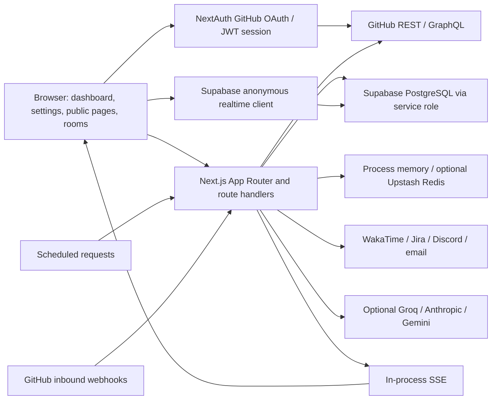

# DevTrack context — audited main

Read alongside [the findings](README.md), [inventory](INVENTORY.md), and [GitHub backlog](GITHUB_BACKLOG.md). Baseline is main a20e51d437a220db4e626a072a9716b67381eca9, fetched/pulled on 2026-10-11. Remote branches were fetched, not merged. All descriptions refer to this main snapshot.

## Product and architecture

DevTrack is a GitHub-connected developer dashboard with activity/streak/goals tracking, public profiles and badges, multi-account support, comparison/leaderboard views, collaboration rooms, coding-time integrations, and optional AI features. Features have accumulated across many contributions; several flows now depend on separate database migrations and optional credentials. A successful frontend build can coexist with disabled integrations or broken server/data contracts.

This depicts code dependencies, not independently verified production connectivity. The browser realtime identity path differs from the NextAuth identity path and is an audit finding.

## Directory map

| Location | Role / audit starting point |
|---|---|
| src/app | App Router pages, layouts, error boundaries and 108 API route files |
| src/app/dashboard | Main authenticated widgets and settings/analysis pages |
| src/app/u/[username] | Public profile, metadata and Node OG image generation |
| src/app/api/metrics | GitHub activity aggregation, caching, periods and pagination |
| src/app/api/cron | Bulk jobs and digest entry points |
| src/app/api/notifications/weekly | Separate legacy webhook dispatch; urgent authorization finding |
| src/app/api/rooms | Room/member/message/invitation APIs |
| src/app/api/webhooks | GitHub events and custom webhook delivery/configuration |
| src/components | 152 TSX component files; several large dashboard widgets |
| src/hooks | Frontend state, fetch and realtime behavior |
| src/lib | Auth, identity resolution, GitHub fetch, caching, streaks, SSRF, cron auth, database clients, AI and integrations |
| src/types | Session/application/database declarations; database type coverage is incomplete |
| src/middleware.ts | Routing/security/rate-limit logic, distinct from route-level guards |
| supabase/schema.sql | Advertised bootstrap schema, not equivalent to all migrations |
| supabase/migrations | 56 files; duplicate timestamps and nonstandard files complicate reproducibility |
| test | Unit/component/library tests plus five separately executed Node files |
| e2e | Playwright browser/API smoke suite; visual checks use their own setup |
| public/openapi.yaml | Public API contract, substantially behind current routes |
| scripts | Env/import/security checks, static-asset copying and supporting tasks |
| .github/workflows | CI/unit/E2E/visual/CodeQL plus contribution/label/assignment workflows |
| next.config.mjs | Standalone output, headers, PWA/cache and integration configuration |
| pnpm-lock.yaml / pnpm-workspace.yaml | Resolved dependency versions, overrides and allowed build scripts |
| docs | Existing architecture/API/deployment guidance; some contracts differ from implementation |

The complete route/table/env/module indexes are generated in INVENTORY.md from tracked source. Counts do not include node_modules, generated Next build files, or this audit directory.

## Feature and data contracts

| Area | Main dependencies | Operational concern |
|---|---|---|
| Sign-in and settings | GitHub OAuth, NextAuth JWT, users | DB sync is best-effort; sign-in success does not prove schema readiness |
| Dashboard metrics | GitHub tokens, REST/search/GraphQL, account resolution, metrics caches | Rate limits, date windows, pagination and account scope need explicit contracts |
| Goals and streaks | goals/history/focus tables, metric collection, timezone/freezes | Several computations/cron paths disagree with their schema or each other |
| Public profiles/badges/OG | Stored privacy/settings plus provider data; Edge and Node image routes | Public filtering and shared calculation rules must be reviewed per endpoint |
| Multi-account / organizations | Linked GitHub accounts and encrypted tokens, org settings | Stable account/user scope matters; mutable logins/display names are not identity IDs |
| Rooms | collaboration_collaboration_collaboration_collaboration_rooms, room_members, room_messages, invitations, browser realtime | Display-name authorization and incorrect realtime table wiring |
| AI insights / tutor / personality / CV / roast | Optional provider keys, metric inputs, cached AI/CV tables | Cost/auth boundaries and failure-to-zero fallback; not all provider flows were exercised |
| Weekly digests / outbound webhooks | users settings, Discord/custom webhooks/email, cron credentials | Multiple implementations with differing guards and URL validation |
| Coding time / Jira | WakaTime credentials/stats, local coding keys/sessions, Jira credentials | Optional secrets and schema additions; real providers were not called |
| Leaderboard / comparisons | User privacy/sponsor fields, snapshots, cache rebuild | Cached completeness, visibility and rebuild contracts |
| PWA and offline dashboard | next-pwa, /sw.js, CSP, runtime API caches | Tested production build has no worker; future authenticated caches need account separation |

## Identity and secret flow

src/lib/auth.ts requests read:user, user:email, repo, read:discussion and read:org scopes. The JWT stores accessToken, githubId and githubLogin; the session callback also returns accessToken to the browser. A periodic provider-token liveness check exists, but does not remove browser token exposure. Linked-account/persisted token paths use server-side encryption utilities and require a valid ENCRYPTION_KEY.

The database has its own users.id (text) and GitHub provider ID/login fields. resolve-user/account utilities bridge these identifiers for many routes. Rooms instead use session.user.name in several ownership/member checks. The GitHub provider's name can be a mutable display name. These identifiers need a single written ownership contract before later fixes.

Server service-role clients bypass RLS, so each route must enforce authorization independently. Browser Supabase access is anonymous unless a separate identity token is supplied; a NextAuth cookie does not itself provide Supabase auth.uid(). Live Supabase grants, publications and policies were not fetched during this audit.

No real credential values were copied into these reports. Environment inventory lists names and source references only. Build/browser helpers blank dotenv-defined child-environment names and use dummy credentials. Safe reproductions stub network/database/model calls; they do not dispatch real notifications or spend provider credits.

## Runtime and verification matrix

| Contract | Current value / evidence |
|---|---|
| App version | package.json 0.2.0; repository marked private for npm publication |
| Framework / UI | Next resolved 16.3.5; React 18; Tailwind 3.4 family; TypeScript 6 |
| Authentication | next-auth v4, GitHub OAuth, JWT sessions |
| Declared runtime | engines Node 20.x; .nvmrc / Docker Node 20 |
| CI runtime | Node 22, pnpm 11.12 |
| Audit runtime | Node 22.14, pnpm 11.9; Windows PowerShell |
| Package manager | pnpm lockfile/workspace; no packageManager pin; Render uses npm |
| Build | validate-env -> next build (Turbopack) -> standalone static-asset copy |
| Env check | Skipped under CI; legitimate private server-secret names otherwise rejected |
| Local verification | Typecheck/build pass; ESLint 0 errors/4 warnings; 2,387 Vitest + 45 Node + 49 Playwright tests pass |
| Historical main coverage | 30.56% lines; soft gate and broken Codecov upload |
| Dependency state | 35 production advisory entries, including one critical; details in DEPENDENCIES.md |

## GitHub context and interpretation

The open backlog contains 124 issues and 23 PRs at the snapshot. Main's September 12 CI and automated-unit workflows are green; October failures often belong to PR automation, not this main SHA. Five dependency PRs have healthy app checks but a failing assignment/label workflow. Some older security/feature PRs have failed checks or conflicts; merging them blindly would mix unverified fixes and unrelated features.

Issue titles/bodies are reports, not established current defects. Some are duplicate, partially addressed, refer to untracked files in another technology stack, or describe historical deployment incidents. GITHUB_BACKLOG.md records current evidence for specific reports and labels the remainder as unverified. This is a point-in-time context index, not an attempt to close/assign issues.

The useful next phase is contract-driven repair in the order recorded in README.md: authorization, dependencies, database/identity, jobs/metrics, realtime/PWA, then deployment/spec/automation/refactoring. No repairs or external state changes were performed in this audit.
